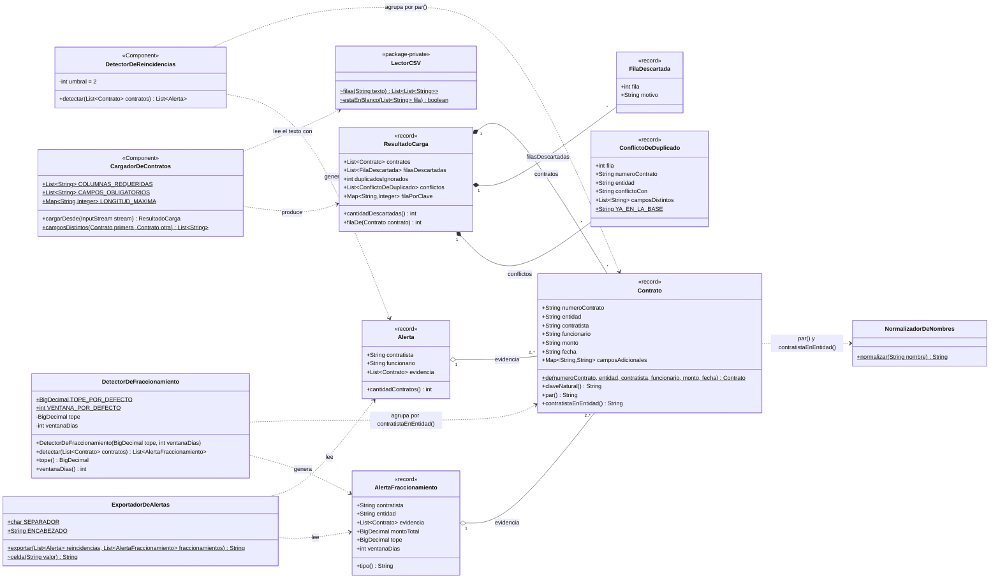
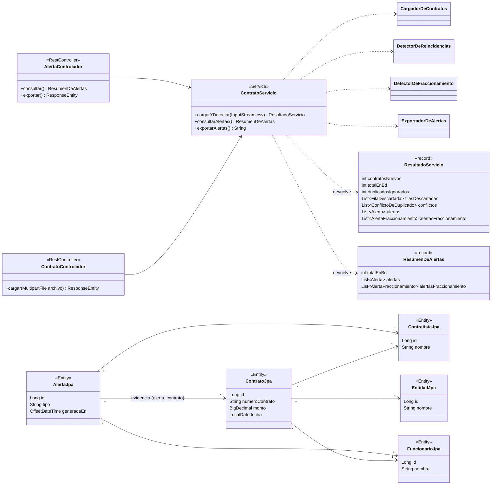

# Modelo de dominio

Las clases reales del paquete `dac.dominio` (`java/src/main/java/dac/dominio/`),
con sus campos, sus métodos públicos y sus relaciones. Los *records* de
Java se marcan `<<record>>`: sus componentes son los campos y cada uno
tiene su método de acceso con el mismo nombre (`contrato.monto()`). Los
miembros estáticos llevan `$`.

El dominio no conoce la base de datos: no importa nada de
`dac.persistencia` ni de Spring Data. Solo `CargadorDeContratos` y
`DetectorDeReincidencias` son `@Component`, para poder inyectarlos.

## 1. Dominio

**Invariantes que el código hace cumplir:**

- `Alerta` y `AlertaFraccionamiento` lanzan `IllegalArgumentException` si
  reciben menos de 2 contratos de evidencia: una alerta sin evidencia es un
  defecto (HU-02, criterio 5).
- `Contrato.claveNatural()` es `numeroContrato` + `entidad` (R-2). `par()` y
  `contratistaEnEntidad()` comparan los nombres **normalizados** (R-5), pero
  los campos guardan el nombre original.
- `monto` y `fecha` son `String` en el dominio (R-8, deuda DT-07). Se
  convierten a `BigDecimal` y `LocalDate` en `DetectorDeFraccionamiento` y al
  guardar, en `ContratoServicio`.
- Las listas de los *records* se copian con `List.copyOf`: son inmutables.

## 2. Cómo se usa desde la aplicación y la persistencia

El dominio se orquesta en `dac.aplicacion` y se guarda con entidades JPA
aparte (`dac.persistencia`), que mapean las 6 tablas de
[esquema-bd.md](esquema-bd.md).

| Clase de dominio | Se guarda como | Tabla |
|---|---|---|
| `Contrato` | `ContratoJpa` (+ `EntidadJpa`, `ContratistaJpa`, `FuncionarioJpa`) | `contrato`, `entidad`, `contratista`, `funcionario` |
| `Contrato.claveNatural()` | restricción única | `uq_contrato_clave_natural (id_entidad, numero_contrato)` |
| `Alerta` | `AlertaJpa` con `tipo = REINCIDENCIA` | `alerta` |
| `Alerta.evidencia` | `AlertaJpa.evidencia` (`@ManyToMany`) | `alerta_contrato` |
| `AlertaFraccionamiento` | **No se guarda** (deuda DT-01) | — |
| `ConflictoDeDuplicado`, `FilaDescartada` | **No se guardan**: viajan en la respuesta (DT-08) | — |

Cada repositorio (`EntidadRepo`, `ContratistaRepo`, `FuncionarioRepo`,
`ContratoRepo`, `AlertaRepo`) extiende `JpaRepository`. Ver el patrón
Repository en [decisiones-tecnicas.md](decisiones-tecnicas.md).
