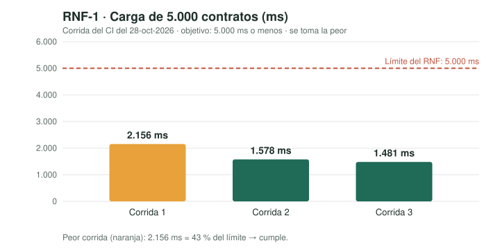
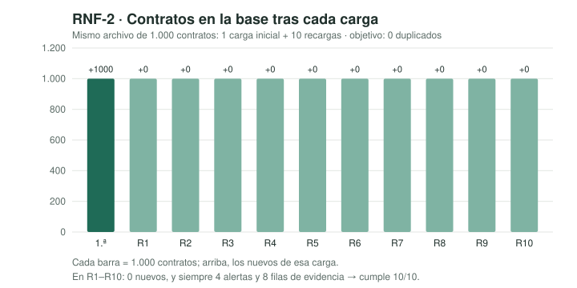

# Seguridad y requisitos no funcionales (Módulo 7 y entrega final)

Evidencia de seguridad y de requisitos no funcionales (RNF) de DAC: el
checklist aplicado con sus hallazgos y correcciones, la superficie de
entrada, los datos que se manejan, los RNF con su medición, la evaluación
contra OWASP Top 10:2025 y la deuda que queda al cierre.

**Regla de este documento:** cada afirmación de "cumple" tiene una prueba
automática o una demostración en vivo en
[demo-entrega-final.md](demo-entrega-final.md), ejecutada el 11 de noviembre
de 2026. Lo que no se pudo demostrar está en la
[sección 7, Deuda conocida al cierre](#7-deuda-conocida-al-cierre), no aquí
como cumplido.

**La pregunta del módulo:** *¿por dónde entraría un dato malicioso a
nuestro sistema, y qué lo detiene?* La puerta principal es el CSV que sube
el analista, pero no es la única: también están el inicio de sesión, la
cookie de sesión, la cabecera HTTP Basic y Actuator (sección 2).

## 1. Checklist de seguridad aplicado

Cada fila es un hallazgo real sobre DAC, no una casilla marcada. **Estado:**
✅ corregido y probado · ⚠️ aceptado como deuda (sección 7).

| # | Control | Hallazgo | Corrección | Evidencia | Estado |
|---|---|---|---|---|---|
| S-01 | Cabeceras de seguridad | Antes no había ninguna. Después, un filtro propio las escribía, pero corría **después** de Spring Security: un 401 salía sin CSP ni `nosniff` | Spring Security escribe en **todas** las respuestas, también en los 401: `Content-Security-Policy` (solo recursos propios), `X-Frame-Options: DENY`, `X-Content-Type-Options: nosniff`, `Referrer-Policy: no-referrer`, `Cache-Control: no-cache, no-store…`. Se eliminó el filtro propio para no duplicarlas | `SeguridadE2ETest` → *cabeceras de seguridad en la página y en la API* (verifica también que no se dupliquen) y *un 401 también lleva las cabeceras* | ✅ |
| S-02 | Validación de entradas en la frontera | Un nombre de más de 200 caracteres o un monto negativo terminaban en **error 500**; se aceptaba cualquier tipo de archivo | Se valida antes de escribir: solo `.csv`, máximo 10 MB, longitud de cada campo igual a su columna, monto no negativo y fecha AAAA-MM-DD, con mensaje que nombra la fila | `SeguridadE2ETest` (4 casos) y `ValidacionEnLaFronteraTest` (3) | ✅ |
| S-03 | Inyección SQL | Sin hallazgo en el código: Spring Data JPA envía los valores como parámetros. Faltaba **demostrarlo** | Ataque simulado: un contratista `x'); DROP TABLE contrato; --` y un funcionario `' OR '1'='1` se guardan como texto | `SeguridadE2ETest` → *inyección SQL* | ✅ |
| S-04 | XSS | Sin hallazgo: la interfaz usa `textContent`. Faltaba demostrarlo y tener una segunda barrera | Prueba de que el JS no usa `innerHTML`, `eval` ni similares; la CSP impide ejecutar scripts ajenos | `SeguridadE2ETest` → *XSS* (2 casos) | ✅ |
| S-05 | Divulgación en errores | El 400 no decía qué fallaba y un error inesperado podía mostrar detalles de Spring | Mensajes útiles sin trazas, clases ni SQL (`server.error.include-*=never`) | `SeguridadE2ETest` → *errores sin detalles internos* | ✅ |
| S-06 | Secretos fuera del repositorio | La clave de la base estaba en `application.properties` y `docker-compose.yml` (DT-04) | Se lee de `.env` (ignorado por Git). El CI falla si alguien vuelve a escribir una clave | `SeguridadE2ETest` → *la clave no está en el código* + paso del CI | ✅ |
| S-07 | Registro de eventos críticos | No quedaba rastro de cargas, exportaciones ni rechazos | Registro `dac.auditoria` con fecha y cantidades, **sin nombres de personas**; los saltos de línea se limpian. Cada carga registra `nuevos`, `yaGuardados` y `duplicadosEnArchivo`: una recarga queda auditada (problema duro) | `SeguridadE2ETest` → *auditoría* y *una recarga queda registrada con 0 nuevos*, `AuditoriaTest` (3) | ✅ |
| S-08 | Inyección de fórmulas al exportar | Corregido en HU-08 | Una celda que empieza por `= + - @` se exporta como texto | `ExportadorDeAlertasTest` | ✅ |
| S-09 | Cargas simultáneas (DT-09) | Dos cargas del mismo contrato a la vez terminaban en un 500 | La base impide el duplicado y la respuesta es **409** con un mensaje claro | Revisado en código (`ManejadorDeErrores`); la prueba concurrente es deuda | ✅ (sin prueba automática) |
| S-10 | Autenticación | Cualquiera con acceso al puerto usaba el sistema | Inicio de sesión (Spring Security): formulario para el navegador y HTTP Basic para clientes; un solo usuario | `SeguridadE2ETest` → *sin credenciales válidas la API responde 401* | ✅ básico (roles → deuda) |
| S-11 | Hash de contraseñas | — | La clave del analista se guarda en memoria como **hash BCrypt** | `SeguridadWeb` (`BCryptPasswordEncoder`) | ✅ |
| S-12 | Credencial por defecto | La aplicación arrancaba con una credencial demo conocida (`analista` / `dac-demo-2026`) si no se configuraba nada | La credencial demo solo existe en el perfil de desarrollo (`application-dev.properties`, `java/ejecutar.sh dev`). Fuera de él, sin `DAC_AUTH_USER` y `DAC_AUTH_PASSWORD` la aplicación **no arranca** y dice qué definir. La clave de Grafana sale de `.env` (antes `admin/admin`) | `CredencialDelAnalistaTest` (3), `SeguridadE2ETest` → *la clave no está en el código*, y demostración en vivo | ✅ |
| S-13 | Actuator expuesto | `/actuator/prometheus` e `/actuator/info` respondían sin sesión | Solo `/actuator/health` es público; `info` y `prometheus` responden **401** sin credenciales. Prometheus raspa con usuario y clave | `SeguridadE2ETest` → *Actuator: health es público; info y prometheus exigen autenticación*, y demostración en vivo | ✅ |
| S-14 | Puertos expuestos a la red | PostgreSQL (5433), Adminer (8081), Prometheus (9090) y Grafana (3000) escuchaban en todas las interfaces | Se publican solo en `127.0.0.1` | `docker port` (demostraciones 17 y 18) | ✅ |
| S-15 | Fuerza bruta en el login | Sin límite de intentos | — | — | ⚠️ deuda |
| S-16 | Mínimo privilegio en la base | La aplicación se conecta con `dac_user`, que es **superusuario** de PostgreSQL | — | `SELECT rolsuper FROM pg_roles` → `t` | ⚠️ deuda |
| S-17 | CSRF | Desactivado (DT-16) | — | — | ⚠️ deuda |
| S-18 | Cifrado en tránsito y en reposo | HTTP sin TLS, JDBC sin SSL, volumen de la base y CSV exportado en texto plano | — | — | ⚠️ deuda |
| S-19 | Dependencias vulnerables | Sin revisión automática (DT-15) | — | — | ⚠️ deuda |

## 2. Superficie de entrada

Todo lo que llega desde fuera se trata como no confiable.

| Entrada | Qué trae | Validación / control | Evidencia |
|---|---|---|---|
| `POST /api/contratos/cargar` · nombre del archivo | Texto libre del cliente | Debe terminar en `.csv`; se limpia de saltos de línea antes de escribirlo en el registro | *solo se aceptan archivos .csv*, `AuditoriaTest` |
| … tamaño del archivo | Bytes | Máximo 10 MB → **413** | *archivo de más de 10 MB* |
| … encabezado | Nombres de columna | Deben estar las 6 columnas requeridas (R-1) → 400 que nombra las que faltan | `CargadorDeContratosTest` |
| … número, entidad, contratista, funcionario | Texto | No vacíos (R-6); longitud máxima 50/200 → fila descartada con motivo | `FilasIncompletasTest`, `ValidacionEnLaFronteraTest` |
| … monto | Texto | Número ≥ 0 → si no, **400 con número de fila** | *monto negativo* |
| … fecha | Texto | AAAA-MM-DD → si no, 400 con número de fila | demostración 12 (`15/01/2026` → 400 "Fila 2: fecha no válida…") |
| … columnas adicionales | Texto | Se aceptan sin validar y vuelven en la respuesta JSON (`camposAdicionales`); no se guardan | — (ver deuda) |
| `POST /login` · `username`, `password` | Formulario | Spring Security; la clave se compara con el hash BCrypt. **Sin límite de intentos** | *sin credenciales válidas…* |
| Cabecera `Authorization: Basic` | Usuario y clave en cada petición | Spring Security (BCrypt en cada petición, ver RNF-3) | *sin credenciales válidas…* |
| Cookie `JSESSIONID` | Identificador de sesión | Spring Security; `HttpOnly`. **Sin CSRF** (deuda) | demostraciones 1 y 9 |
| `GET /api/alertas`, `GET /api/alertas/exportar` | Sin parámetros | Exigen sesión → 401 sin credenciales | `AlertasE2ETest`, *401* |
| `/actuator/health` | Sin parámetros | Público; solo devuelve `UP`/`DOWN`, sin detalles | *Actuator…* |
| `/actuator/info`, `/actuator/prometheus` | Sin parámetros | Exigen autenticación → 401 | *Actuator…* |
| `/logout` | — | Cierra la sesión; después la API responde 401 | demostración 10 |
| Archivos estáticos (`/`, `/login.html`, CSS, JS) | — | La página principal exige sesión (el navegador va al login); el login y sus estilos son públicos | demostración 1 |
| Indirectas: PostgreSQL :5433, Adminer :8081, Prometheus :9090, Grafana :3000 | Conexiones locales | Solo en `127.0.0.1`; claves desde `.env` | `docker port` |

### Modelo básico de amenazas

| Activo | Amenaza | Cómo entraría | Qué lo detiene hoy | Impacto |
|---|---|---|---|---|
| Base de contratos y alertas | Borrado o lectura indebida | Inyección SQL en un nombre del CSV | Consultas parametrizadas (S-03) | Alto |
| Navegador del analista | Ejecución de código ajeno | Un `<script>` en un nombre del CSV | `textContent` + CSP, también en los 401 (S-01, S-04) | Alto |
| Excel de quien recibe el reporte | Ejecución de fórmulas | Un nombre que empieza por `=` | Neutralización al exportar (S-08) | Alto |
| Datos sensibles | Filtración | Usar DAC sin sesión | Inicio de sesión (S-10); sin credencial por defecto (S-12) | Alto |
| Datos sensibles | Filtración | Adivinar la clave del analista | Nada todavía: sin límite de intentos (S-15, deuda) | Alto |
| Métricas internas | Reconocimiento | Leer `/actuator/prometheus` | Exige autenticación (S-13) | Medio |
| Base de datos | Acceso directo | Conectarse al puerto 5433 desde la red | Puerto solo en `127.0.0.1` (S-14); pero la app usa un superusuario (S-16, deuda) | Alto |
| Disponibilidad | Saturar el servidor | Archivos enormes | Límite de 10 MB (S-02) | Medio |
| Clave de la base | Uso indebido | Leerla en GitHub | `.env` fuera del repositorio (S-06) | Alto |
| Registro de auditoría | Falsificarlo | Saltos de línea en un dato | Limpieza al registrar (S-07) | Medio |

## 3. Datos que maneja DAC y cómo se protegen

| Dato | ¿Se guarda? | ¿Sensible? | Protección hoy |
|---|---|---|---|
| Nombres de funcionarios | Sí, en `funcionario` | **Sí: dato personal** (persona natural) | Login; `Cache-Control: no-store`; no aparecen en el registro de auditoría |
| Nombres de contratistas | Sí, en `contratista` | **Sí** cuando el contratista es persona natural | Igual que arriba |
| Alertas (un par señalado y sus contratos) | Sí, en `alerta` y `alerta_contrato` | **Sí: lo más delicado.** Asocia a una persona con una sospecha (S-6) | Igual que arriba; la alerta no lleva puntajes ni calificativos (R-4) |
| Entidad, número, monto y fecha del contrato | Sí, en `entidad` y `contrato` | Información pública de contratación | — |
| CSV exportado | En el equipo de quien lo descarga | Sí (contiene las alertas) | Fórmulas neutralizadas (S-08) |
| Clave del analista | No en disco: hash BCrypt en memoria | Sí | BCrypt (S-11); el valor viene de `.env` |
| Clave de la base y de Grafana | En `.env`, local | Sí | Fuera del repositorio (S-06) |

**Cifrado: no hay, ni en tránsito ni en reposo.** La aplicación corre en
HTTP, la conexión JDBC no usa SSL y el volumen de PostgreSQL y el CSV
exportado quedan en texto plano. Es aceptable solo mientras DAC corra en
`localhost` con datos ficticios ([sección 7](#7-deuda-conocida-al-cierre)).
Los datos reales van en `data/privado/`, que Git ignora (R-7).

## 4. Requisitos no funcionales

Resumen de los ocho atributos del checklist de clase, más la integridad, que
es el problema duro del proyecto:

| Atributo | Requisito | Cómo se verifica | Estado hoy |
|---|---|---|---|
| Performance | RNF-1 | `RequisitosNoFuncionalesTest`, en cada corrida del CI | ✅ Cumple |
| Integridad | RNF-2 | `RequisitosNoFuncionalesTest`, en cada corrida del CI | ✅ Cumple |
| Scalability | RNF-3 | k6 con 200 usuarios, a mano | ✅ con sesión · ❌ con Basic en cada petición |
| Security | Sección 1 | `SeguridadE2ETest` y otras | ✅ básico, con deuda declarada |
| Availability | RNF-4 | `/actuator/health` | ⚠️ Parcial |
| Maintainability | RNF-5 | CI en cada Pull Request | ⚠️ Parcial |
| Accessibility | RNF-6 | Auditoría con axe o Lighthouse | ❌ No verificado |
| Deployability | RNF-7 | Arranque desde cero del guion de demostración | ⚠️ Parcial |
| Extensibility | RNF-8 | Revisión de código | ⚠️ Parcial |

### RNF-1 — Rendimiento de la carga ✅

| | |
|---|---|
| **Escenario** | El analista carga un archivo de **5.000 contratos** |
| **Objetivo** | La respuesta, con las dos señales calculadas, llega en **5 segundos o menos** |
| **Método** | `RequisitosNoFuncionalesTest`: por HTTP real, 1 carga de calentamiento y 3 medidas con la base vacía antes de cada una; se toma la **peor**. Datos ficticios con semilla fija (346 KB) |
| **Resultado (CI, 28/10/2026)** | Runner `ubuntu-24.04`, 4 núcleos, Java 21: 2.156 · 1.578 · 1.481 ms. **Peor: 2.156 ms** (43 % del límite) |
| **Resultado (local, 11/11/2026)** | Apple M4 Pro, Java 26: 1.975 · 2.015 · 1.331 ms. **Peor: 2.015 ms** |

**Hallazgo y corrección:** el servicio hacía varias consultas por cada fila
y cada una obligaba a Hibernate a revisar todo lo cargado: el tiempo crecía
más que la cantidad de filas. Ahora se lee lo existente **una sola vez**
([Decisión 25](decisiones-tecnicas.md)).



### RNF-2 — Integridad ante recargas (idempotencia) ✅

| | |
|---|---|
| **Escenario** | El mismo archivo de **1.000 contratos** se carga **10 veces seguidas** |
| **Objetivo** | **0 duplicados en 10 de 10** recargas: mismos contratos, alertas y filas de evidencia que tras la primera |
| **Método** | `RequisitosNoFuncionalesTest` cuenta `contrato`, `alerta` y `alerta_contrato` después de cada recarga |
| **Resultado (CI 28/10 y local 11/11)** | Tras la 1.ª carga: 1.000 contratos, 4 alertas, 8 filas de evidencia. En las 10 recargas: **0 contratos nuevos**, cantidades iguales en **10 de 10** |



### RNF-3 — Escalabilidad ante usuarios concurrentes

| | |
|---|---|
| **Escenario** | **200 usuarios** consultando a la vez el estado del sistema (`GET /api/alertas`, que recalcula las dos señales sobre todo el histórico), más la página de login como línea base |
| **Datos** | **1.200 contratos ficticios** generados con semilla fija por `rnf/k6-cargar-datos.js` (producen 248 reincidencias y 13 fraccionamientos) |
| **Objetivo** | Menos del **1 %** de errores y **p95 ≤ 1.500 ms** en `/api/alertas` |
| **Método** | [k6](https://k6.io) (`rnf/k6-concurrencia.js`): sube a 200 usuarios en 15 s, los sostiene 30 s y baja en 10 s. Solo lecturas |
| **Condiciones** | 11/11/2026, local: Apple M4 Pro (12 núcleos), servidor Spring Boot con el pool de conexiones por defecto (10), PostgreSQL 16 en contenedor |

| Modo de autenticación | Peticiones | Errores | p95 `/api/alertas` | p95 página | Resultado |
|---|---|---|---|---|---|
| **Sesión** (`AUTH_MODO=sesion`): cada usuario inicia sesión una vez y usa la cookie, como el analista en el navegador | 46.672 (849/s) | **0 %** | **777 ms** | 9 ms | ✅ **Cumple** |
| **Basic en cada petición** (por defecto), como un cliente programático | 10.490 (190/s) | **0 %** | **2,72 s** | 42 ms | ❌ **No cumple** el p95 |

**Hallazgo:** con HTTP Basic, Spring Security verifica el hash BCrypt en
**cada** petición, y eso cuesta CPU de forma deliberada. En una prueba
secuencial de 20 peticiones, una con Basic tardó 87 ms en promedio y una con
sesión 19 ms. Con 200 usuarios a la vez ese costo domina: el p95 pasa de
777 ms a 2,72 s. El analista usa la pantalla con sesión, así que el
escenario real cumple. Un cliente que use Basic de forma masiva no cumple, y
queda como deuda ([sección 7](#7-deuda-conocida-al-cierre)). La medición
anterior, del 4/11 y sin inicio de sesión, dio un p95 de 771 ms. Coincide
con el modo sesión de hoy.

**Evidencia:** `docs/seguridad/k6-resumen-sesion.json` y
`docs/seguridad/k6-resumen.json` (`--summary-export`), con la salida legible
en `docs/seguridad/k6-salida-sesion.txt` y `docs/seguridad/k6-salida.txt`.
Cómo repetirla: [demo-entrega-final.md](demo-entrega-final.md), demostración 15.

### Tiempos de las consultas SQL (EXPLAIN ANALYZE)

Para saber si la base es el cuello de botella, se midieron con
`EXPLAIN (ANALYZE, BUFFERS)` las dos consultas de lectura de DAC, con el SQL
equivalente al que genera Hibernate y **5.000 contratos** ficticios en la base
(20 entidades, 600 contratistas, 250 funcionarios; `rnf/k6-cargar-datos.js`,
semilla 2026). Cada consulta se corrió 3 veces.

| Consulta | Plan | Tiempo de ejecución (3 corridas) |
|---|---|---|
| `ContratoRepo.findAllConFetch()` — todos los contratos con entidad, contratista y funcionario | 3 *hash joins* + lectura secuencial de `contrato` + orden por id (en memoria, 1 MB) | **2,97 · 2,46 · 2,34 ms** (planificación 0,50 · 0,15 · 0,11 ms) |
| `findByNumeroContratoAndEntidad` — búsqueda por clave natural (R-2), con parámetros | *Index Scan* sobre `uq_contrato_clave_natural`, 1 fila, 3 páginas leídas | **0,016 · 0,004 · 0,009 ms** |

- **Conclusión:** el SQL no es el cuello de botella. Leer los 5.000 contratos
  cuesta unos 3 ms; el resto del tiempo de `GET /api/alertas` (cientos de ms
  bajo carga, RNF-3) se va en recalcular las dos señales en Java y en armar
  el JSON. Por eso la mejora propuesta es cachear o precalcular las alertas
  (DT-01), no agregar índices.
- La clave natural usa el índice único que ya garantiza la idempotencia: la
  misma restricción sirve para integridad y para rendimiento.
- La lectura secuencial en `findAllConFetch` es lo correcto: la consulta pide
  **todas** las filas, así que un índice no ayudaría.
- **Evidencia:** planes completos en
  [`seguridad/explain-analyze.txt`](seguridad/explain-analyze.txt).
  Reproducible con `docker exec -i dac_db psql -U dac_user -d dac < rnf/explain-analyze.sql`.

### RNF-4 — Disponibilidad ⚠️ Parcial

- **Requisito:** un monitor externo puede saber en menos de 2 s si DAC está
  vivo y si puede atender (incluida la base), sin credenciales.
- **Cómo se verifica:** `curl http://localhost:8080/actuator/health` con la
  base arriba y con la base detenida.
- **Estado hoy:** con la base arriba responde `{"status":"UP"}` al instante
  y sin credenciales (✅, probado en `SeguridadE2ETest` y en vivo). Con la base
  **detenida**, la petición se quedó esperando más de 15 s sin responder, y
  `/actuator/health/readiness` siguió diciendo `UP` porque no incluye la
  base (❌, comprobado el 11/11). Tampoco hay una meta de tiempo en línea ni
  alertas. Ver la deuda.

### RNF-5 — Mantenibilidad ⚠️ Parcial

- **Requisito:** ningún cambio entra a `main` sin pasar la suite completa
  contra PostgreSQL real, y cada regla de negocio tiene su prueba.
- **Cómo se verifica:** GitHub Actions (`.github/workflows/ci.yml`) corre
  `mvn -B test` en cada Pull Request; `mvn test` local.
- **Estado hoy:** ✅ **88 pruebas, 0 fallos** (59 de dominio y 29 de punta a
  punta) en local el 11/11; el CI las corre en el Pull Request de esta
  entrega. ❌ No se mide la cobertura (JaCoCo) ni hay
  análisis estático.

### RNF-6 — Accesibilidad ❌ No verificado

- **Requisito:** las dos pantallas (login y principal) cumplen WCAG 2.1 AA:
  idioma declarado, cada campo con su etiqueta, se pueden usar solo con el
  teclado y tienen contraste suficiente.
- **Cómo se verificaría:** auditoría con axe o Lighthouse (meta: 90 o más) y
  una prueba manual navegando solo con el teclado.
- **Estado hoy:** el HTML declara `lang="es"`, usa `<label>` en los campos y
  atributos `aria-*`/`role` en las pestañas y los mensajes. **No se ha
  ejecutado ninguna auditoría**, así que no se puede afirmar que cumpla.

### RNF-7 — Despliegue ⚠️ Parcial

- **Requisito:** cualquier integrante levanta DAC desde cero en su
  computador con `cp .env.example .env`, `docker compose up -d` y
  `java/ejecutar.sh`, sin pasos manuales adicionales.
- **Cómo se verifica:** el arranque desde cero de
  [demo-entrega-final.md](demo-entrega-final.md) (demostración 0).
- **Estado hoy:** ✅ en local, ejecutado el 11/11. ❌ No hay imagen Docker de
  la aplicación ni despliegue continuo a un servidor: DAC solo corre en
  `localhost`.

### RNF-8 — Extensibilidad ⚠️ Parcial

- **Requisito:** cambiar los parámetros de una señal no exige tocar código,
  y agregar una señal nueva no exige cambiar la carga ni la persistencia de
  contratos.
- **Cómo se verifica:** revisión de código.
- **Estado hoy:** el tope y la ventana del fraccionamiento se cambian en
  `application.properties` (`ConfiguracionDeSenales`) ✅. Pero el umbral de
  reincidencia (2) está fijo en `DetectorDeReincidencias`, y cada señal se
  invoca a mano desde `ContratoServicio`, sin una interfaz común ❌. Se
  verificó leyendo el código, no con una prueba.

## 5. Observabilidad

DAC publica métricas con **Spring Boot Actuator + Micrometer**:

- `GET /actuator/health`: **público**. Estado del servicio (`UP`/`DOWN`), sin detalles.
- `GET /actuator/prometheus`: **exige autenticación**. Métricas en formato
  Prometheus: latencia por endpoint (`http_server_requests_seconds`), pool de
  conexiones (`hikaricp_connections`), memoria y GC de la JVM.
- `GET /actuator/info`: **exige autenticación**.

El stack de visualización es opcional y vive en
[`observabilidad/`](../observabilidad/). Prometheus raspa la aplicación **con
usuario y clave** (los de `.env`) y Grafana arranca con Prometheus como fuente
de datos y con su clave de administrador tomada de `GRAFANA_ADMIN_PASSWORD`.

```bash
docker compose --env-file .env -f observabilidad/docker-compose.observabilidad.yml up -d
# Prometheus: http://localhost:9090 (Status → Targets) · Grafana: http://localhost:3000 (admin / GRAFANA_ADMIN_PASSWORD)
```

**Verificado el 11/11:** el objetivo `dac` aparece `up` en Prometheus,
raspado con autenticación. Grafana rechaza `admin/admin` (401) y acepta la
clave de `.env`. Los dos puertos se publican solo en `127.0.0.1`.

**Registros:** el registro de auditoría `dac.auditoria` sale por la consola
del servidor. No se escribe en archivo ni tiene retención, y el inicio de
sesión no queda registrado (deuda). No hay tableros de Grafana preparados ni
alertas configuradas (deuda).

## 6. Evaluación OWASP Top 10:2025

Evaluación **estricta**: una categoría solo es ✅ si no queda un hueco
conocido en DAC. Los ⚠️ remiten a la [sección 7](#7-deuda-conocida-al-cierre).

| Código | Categoría | Qué hay | Qué falta | Estado |
|---|---|---|---|---|
| **A01** | Broken Access Control | Inicio de sesión obligatorio (S-10); Actuator cerrado salvo `health` (S-13). No hay SSRF: DAC no hace peticiones salientes | Roles (analista/coordinador); CSRF desactivado (S-17) | ⚠️ |
| **A02** | Security Misconfiguration | Cabeceras en todas las respuestas, también en los 401 (S-01); errores sin trazas (S-05); sin credencial por defecto (S-12); puertos solo en `127.0.0.1` (S-14) | La aplicación usa un superusuario de PostgreSQL (S-16) | ⚠️ |
| **A03** | Software Supply Chain Failures | Versiones fijadas (Spring Boot 3.3.5) | Escaneo automático de dependencias (S-19) | ⚠️ |
| **A04** | Cryptographic Failures | Clave del analista con BCrypt (S-11) | **Sí se guardan datos personales** (sección 3) y no hay cifrado en tránsito ni en reposo (S-18) | ⚠️ |
| **A05** | Injection | Consultas parametrizadas, ataque SQLi probado (S-03); XSS frenado con `textContent` + CSP (S-04); fórmulas de CSV neutralizadas (S-08) | — | ✅ |
| **A06** | Insecure Design | Entradas validadas en la frontera (S-02); superficie de entrada y modelo de amenazas documentados (sección 2) | Límite de intentos de login (S-15); alertas que se recalculan en cada consulta (RNF-3, DT-01) | ⚠️ |
| **A07** | Authentication Failures | BCrypt; 401 sin credenciales; no hay credencial por defecto fuera del perfil dev | Fuerza bruta sin límite (S-15); un solo usuario compartido | ⚠️ |
| **A08** | Software or Data Integrity Failures | Idempotencia garantizada por la base (RNF-2, `uq_contrato_clave_natural`); conflictos reportados (HU-06); auditoría a prueba de inyección de líneas (S-07) | — | ✅ |
| **A09** | Security Logging and Alerting Failures | Auditoría de cargas, exportaciones y rechazos, sin datos personales (S-07) | El login no se registra; el registro sale solo por consola; no hay alertas | ⚠️ |
| **A10** | Mishandling of Exceptional Conditions | 400/409/413 con mensaje y sin trazas; una carga rechazada no deja nada a medias (transacción) | — | ✅ |

## 7. Deuda conocida al cierre

La deuda tiene un **registro único** en [deuda-tecnica.md](deuda-tecnica.md),
con su prioridad, su riesgo, la consecuencia de mantenerla y cómo se paga.
Aquí solo se enlaza la que toca seguridad y RNF:

| Tema | Deuda |
|---|---|
| Roles (analista / coordinador) | [DT-03](deuda-tecnica.md#dt-03--faltan-roles--media-antes-sin-inicio-de-sesión) |
| Superusuario de la base | [DT-19](deuda-tecnica.md#dt-19--la-aplicación-usa-un-superusuario-de-la-base--alta) |
| CSRF desactivado | [DT-16](deuda-tecnica.md#dt-16--csrf-desactivado--alta-al-desplegar) |
| Sin límite de intentos de login | [DT-20](deuda-tecnica.md#dt-20--sin-límite-de-intentos-de-inicio-de-sesión--alta) |
| Sin HTTPS | [DT-14](deuda-tecnica.md#dt-14--sin-https--alta-al-desplegar) |
| Sin cifrado en reposo | [DT-21](deuda-tecnica.md#dt-21--sin-cifrado-en-reposo--alta-al-desplegar) |
| Basic masivo no cumple RNF-3 | [DT-17](deuda-tecnica.md#dt-17--con-http-basic-en-cada-petición-no-se-cumple-rnf-3--media) |
| Health no detecta la caída de la base (RNF-4) | [DT-18](deuda-tecnica.md#dt-18--health-no-detecta-a-tiempo-la-caída-de-la-base--media) |
| Sin escaneo de dependencias | [DT-15](deuda-tecnica.md#dt-15--sin-revisión-de-dependencias--media) |
| Login sin auditar, registro solo por consola | [DT-22](deuda-tecnica.md#dt-22--el-login-no-se-audita-y-el-registro-solo-sale-por-consola--media) |
| Sin tableros ni alertas en Grafana | [DT-24](deuda-tecnica.md#dt-24--sin-tableros-ni-alertas-en-grafana--baja) |
| Accesibilidad sin auditar (RNF-6) | [DT-25](deuda-tecnica.md#dt-25--accesibilidad-sin-auditar--baja) |
| Sin cobertura ni análisis estático (RNF-5) | [DT-26](deuda-tecnica.md#dt-26--sin-cobertura-ni-análisis-estático--baja) |
| Sin imagen Docker ni despliegue continuo (RNF-7) | [DT-27](deuda-tecnica.md#dt-27--sin-imagen-docker-de-la-aplicación-ni-despliegue-continuo--baja) |
| Columnas adicionales del CSV sin validar | [DT-28](deuda-tecnica.md#dt-28--columnas-adicionales-del-csv-sin-validar--baja) |
| Cargas simultáneas sin prueba automática | [DT-09](deuda-tecnica.md#dt-09--cargas-simultáneas--baja) |
| Etiquetas de release inexistentes | [DT-29](deuda-tecnica.md#dt-29--las-etiquetas-de-release-no-existen--baja) |

## 8. Evidencias

- [Semana 13](seguridad/semana-13.md) y [semana 14](seguridad/semana-14.md):
  checklist inicial, ataques simulados, RNF-1 y RNF-2 con gráficas (registro
  histórico de esas semanas).
- **Entrega final (11/11/2026):**
  - k6: `seguridad/k6-resumen.json`, `seguridad/k6-resumen-sesion.json` y su salida legible (`seguridad/k6-salida*.txt`).
  - SQL: `seguridad/explain-analyze.txt` y el script `rnf/explain-analyze.sql`.
  - Pruebas nuevas: `SeguridadE2ETest` (401 con cabeceras, cabeceras sin duplicar, Actuator) y `CredencialDelAnalistaTest`.
  - Guion ejecutado: [demo-entrega-final.md](demo-entrega-final.md).

## 9. Correspondencia con el checklist de clase (28 de octubre de 2026)

| Punto de clase | Dónde se cubre | Estado |
|---|---|---|
| Seguridad BD: NOT NULL y PK | `db/schema.sql`: PK en las 6 tablas, NOT NULL salvo `monto`/`fecha` (R-6, Decisión 17) y `nit` | ✅ |
| Seguridad BD: consultas parametrizadas | Spring Data JPA; SQLi probado (S-03) | ✅ |
| Seguridad BD: permisos del usuario | Superusuario (S-16) | ⚠️ deuda DT-19 |
| SQL Injection, XSS, fórmulas | S-03, S-04, S-08 (ataques simulados) | ✅ |
| Login y contraseñas | Inicio de sesión + BCrypt + sin credencial por defecto (S-10, S-11, S-12) | ✅ básico (roles, DT-03) |
| Superficie de entrada | Sección 2 | ✅ |
| Datos sensibles y cifrado | Sección 3 | ⚠️ sin cifrado (DT-14, DT-21) |
| OWASP Top 10:2025 | Sección 6 (evaluación estricta) | ✅ evaluado, 3 de 10 sin huecos |
| RNF de los 8 atributos | Sección 4 | ✅ escritos; 3 cumplen, 4 parciales, 1 sin verificar |
| k6 con 200 usuarios | RNF-3 | ✅ con sesión · ❌ con Basic (DT-17) |
| Tiempos de consultas SQL | Sección 4, EXPLAIN ANALYZE | ✅ |
| Grafana / observabilidad | Sección 5 | ✅ métricas y Prometheus · ⚠️ sin tableros (DT-24) |
| Documentación `docs/seguridad-y-rnf.md` | Este archivo | ✅ |
| Declarar uso de IA | [uso-ia.md](uso-ia.md) | ✅ |
