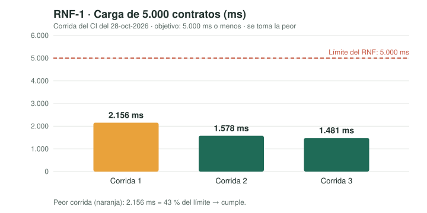
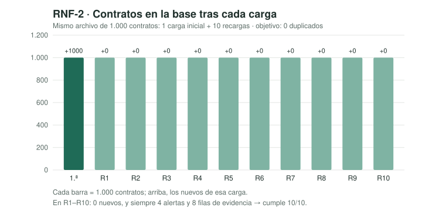

# Semana 14 — RNF verificables y estabilización (evidencias)

Registro de evidencias de la semana 14 del Módulo 7. El método completo
de medición está en
[docs/seguridad-y-rnf.md](../seguridad-y-rnf.md#2-requisitos-no-funcionales-verificados).

## 1. Verificación de los RNF

| RNF | Escenario | Objetivo | Resultado | Estado |
|---|---|---|---|---|
| RNF-1 Rendimiento | Cargar un CSV de 5.000 contratos por HTTP | Respuesta con las dos señales en **≤ 5.000 ms** (peor de 3 corridas) | **2.156 ms** (43 % del límite) | ✅ Cumple |
| RNF-2 Integridad | Recargar 10 veces el mismo CSV de 1.000 contratos | **0 duplicados en 10 de 10** | 0 contratos nuevos, 4 alertas y 8 filas de evidencia en las 10 | ✅ Cumple |

**Condiciones:** runner `ubuntu-24.04` de GitHub Actions, PostgreSQL 16
con el esquema real, datos ficticios de semilla fija. Medición del CI del
28 de octubre de 2026 (PR #6). Cada ejecución del CI vuelve a medir y
publica el resultado en el *Summary* y en el artefacto `reporte-pruebas`.

## 2. Estabilización

| Paso | Qué se hizo |
|---|---|
| Detectar | Las pruebas de seguridad y de RNF encontraron cinco defectos |
| Priorizar | Primero los que daban error 500 (críticos), luego la lentitud |
| Corregir | Error 500 con nombres largos, con montos negativos y con cargas simultáneas (ahora 409 con mensaje); mensajes de error sin explicación; carga lenta con archivos grandes |
| Probar | 82 pruebas en verde en el CI |
| Verificar | RNF-1 y RNF-2 cumplen |

**Criterios de estabilidad:**

- ✅ Sin errores críticos abiertos.
- ✅ Todas las pruebas pasan en el CI (82: 56 de dominio y 26 punta a punta).
- ✅ RNF verificados con evidencia.
- ✅ Seguridad básica aplicada y probada.
- ⚠️ La carga simultánea (DT-09) responde bien pero aún no tiene prueba automática.

## 3. Release 0.3 — release candidate

- **Alcance congelado:** las 8 historias del backlog; no se agregan
  historias nuevas.
- **Etiqueta:** `v0.3.0-rc1` sobre `main` después de fusionar los PR #5
  y #6 ([Decisión 28](../decisiones-tecnicas.md)).
- **Documentación:** el [README](../../README.md) tiene la guía de
  instalación, cómo correrlo y la solución de problemas comunes.

## 4. Registro de sugerencias de IA

Aceptadas, modificadas y no aplicadas, en
[docs/uso-ia.md](../uso-ia.md).
